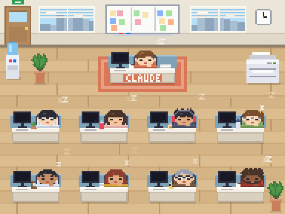

# Agent Office

Watch your Claude Code agents work in a pixel-art office. The main agent is the boss. Every subagent is a staff member who wakes up when given a task, works at their desk, sends a report flying to the boss when done, and goes back to sleep.



**[Website](https://donasman.github.io/pixel-agent-office/)** · [한국어 설치 안내](#설치-한국어)

## Quick start

```
npx pixel-agent-office
```

Node.js 18 or later. The first time, it offers to install the Claude Code plugin whose hooks tell the office what claude is doing: press Enter. Then use Claude Code as usual, in any terminal or IDE. The office opens in an app window (Edge or Chrome) or in your default browser. Close the window and the viewer stops. A claude that was already running before the plugin was installed shows up after you restart it. The office is in English, or in Korean when your browser's language is Korean.

To install the plugin yourself instead, run this in Claude Code:

```
/plugin marketplace add donasman/pixel-agent-office
/plugin install agent-office@agent-office
```

On Windows without Git for Windows, install `agent-office-powershell@agent-office` instead (`npx` picks it for you).

## 설치 (한국어)

```
npx pixel-agent-office
```

Node.js 18 이상이 필요합니다. 처음 실행하면 Claude Code 플러그인을 설치할지 물어봅니다. 플러그인이 claude가 하는 일을 사무실에 알려 주니 Enter를 누르세요. 그다음부터는 터미널이든 IDE든 평소처럼 Claude Code를 쓰면 됩니다. 사무실은 앱 창(Edge 또는 Chrome)이나 기본 브라우저로 열리고, 창을 닫으면 뷰어도 꺼집니다. 플러그인을 설치하기 전부터 켜져 있던 claude는 다시 시작해야 사무실에 나타납니다. 브라우저 언어가 한국어면 사무실 화면도 한국어로, 아니면 영어로 나옵니다.

플러그인을 직접 설치하려면 Claude Code에서 다음을 실행하세요.

```
/plugin marketplace add donasman/pixel-agent-office
/plugin install agent-office@agent-office
```

Git for Windows가 없는 Windows에서는 두 번째 명령 대신 `/plugin install agent-office-powershell@agent-office`를 실행하세요. `npx`로 설치하면 알아서 골라 줍니다.

## What happens in the office

| In Claude Code | In the office |
|---|---|
| Agents you defined (`.claude/agents/*.md`) | Each has a desk with its name on it before any work comes in |
| A subagent starts | A sleeping staff member wakes up with a "!" and gets the task's name |
| Edit / Write, Read / Grep, Bash | Typing, reading papers, a terminal on the monitor |
| A subagent finishes | Its report flies to the boss's desk; the boss reads the first line |
| Agent teams | Each teammate gets a desk on the lead's floor; given more work later, it wakes at the same desk |
| More agents at work than the 8 desks | Up to six temps stand beside the boss; a "+N" on the door counts the ones waiting outside |
| Permission prompt | A "?" bubble, a chime, and Allow / Deny buttons under the office (see below) |
| A tool still running after 5 minutes | A "5MIN" bubble and a "!" on its floor's tab: a hung command, or claude closed mid-task |
| A tool fails | Sweat and "OOPS"; three failures in a row make the monitor smoke |
| `git commit` / tests pass | Confetti / the whole office claps |
| Context compaction | A robot vacuum cleans up and the report pile is filed away |
| Rate limit or overload | The lights go out |

Click anyone to see their task, recent tools, work time and last report, and for an agent you defined, what it does. Right-click someone to pick their look from the 13 in the art (it stays with that desk, or the boss, on every floor; "Default" undoes it). Three office themes: day, late night and wood.

### Under the office

- **Staff**: who is working on what, then the agents you defined that are free, each with what it does. The office has 8 desks: with more agents than that, the first 8 are seated, and one without a desk (an empty square in the list) takes the desk that has been idle the longest when it gets work.
- **Files**: the files edited this session (Edit/Write), newest first, with who edited them and how often. Changes made by commands (Bash) aren't listed.
- **Reports**: every report subagents and teammates sent back, in full. Click one to open it; Copy copies it.
- **Log**: what happened on this floor, in order: instructions, tools used, reports, permission prompts, compactions.
- **Context**: how full the main agent's context is, from its transcript (current models have a 1M-token window).
- **To-do**: claude's to-do list (TaskCreate / TaskUpdate), also drawn as sticky notes on the whiteboard (to do / doing / done). It shows up only while claude keeps one. Claude Code gives the current models (Opus, Sonnet and Haiku 5.5, Fable) these tools only when `CLAUDE_CODE_ENABLE_TODO_TOOLS=1` is set; older models such as Opus 4.7 have them by default.

### Usage gauge

At the top, `5h 34% Week 61%`: how much of your subscription's 5-hour and weekly limits is used, with the reset times on hover. Claude Code hands these numbers only to a status line, so the gauge needs the office's status line script. The desktop app sets it up for the claude it runs. Elsewhere, add this to `~/.claude/settings.json` (the office copies the script to `~/.agent-office/` whenever it starts):

```json
"statusLine": { "type": "command", "command": "node ~/.agent-office/statusline.js" }
```

It prints nothing itself. If you already have a status line, keep it by moving its command into `"env": { "AGENT_OFFICE_STATUSLINE": "<your command>" }`; the script runs it after passing the numbers on.

### Answer permission prompts from the office

When claude asks before running a tool, the office shows what it wants to do (`Approval needed Claude: Bash npm install …`) with Allow and Deny. Claude's own prompt appears in the terminal at the same time, and whichever you answer first counts. Allow means "Yes" for this one call; for "always allow", answer in the terminal. Only the office page itself can answer, and only while it is open.

### Notifications

Click Turn on notifications once (the browser asks for permission). While the office window isn't the one in front, Windows notifications tell you, from any floor, when a permission prompt is still unanswered after 5 seconds, when claude has finished, when it stopped on an error, and when a tool has been running for 5 minutes. Clicking one brings up that floor. The desktop app blinks the taskbar instead.

Running several claude sessions at once? Each gets its own floor, named after its folder (`1F readme`, `2F blog`). Tabs switch floors, and the view moves to a floor that needs you (a permission prompt) or comes alive while yours is quiet; turn that off with Follow. When a session ends its floor closes, and restarting claude in that folder opens it again.

The art lives in `public/art/`. It is cut out of the pixel-art design by `node tools/import-design.js` (inputs in `tools/design/`).

## How it works

```
Claude Code hooks ──curl──▶ local server (127.0.0.1) ──SSE──▶ office page
        │
        └─ reads ~/.agent-office/port, which exists only while the office is open
```

- The hooks run in the background (`async`), so they never slow Claude down. The one exception is the permission prompt's hook: it waits for an answer from the office (up to 10 minutes), while claude's own prompt is already on screen, so it holds nothing up either.
- When the office isn't open there is no port file, and the hooks exit at once: nothing is sent and nothing is printed.
- Everything stays on your machine. The server keeps only what the office draws (tool names, task names, a report's first line) and drops file contents and command output. To show the boss's model, it reads the end of the session transcript. To name the staff, it reads the name and description of each agent you defined (`.claude/agents/*.md` in the session's folder and in `~/.claude`), not the agent's prompt.

Requirements: `bash` and `curl`. macOS and Linux have both. On Windows, Claude Code runs hooks in Git Bash, which includes curl. On Windows without Git for Windows, Claude Code runs hooks in PowerShell instead: install `agent-office-powershell@agent-office` rather than `agent-office@agent-office`. (The desktop app picks the right one itself.)

## Desktop app with a built-in terminal (optional, Windows)

Claude on the left, the office on the right, in one window:

```
git clone https://github.com/donasman/pixel-agent-office.git
cd pixel-agent-office
npm install
npm start
```

It runs your own `claude` login, so it uses your subscription as usual. `npm start -- C:\Dev\my-project` skips the first folder question.

- Drag the bar between the terminal and the office to share the width (or focus it and use ←/→); double-click it to reset. The width is remembered.
- **+ New session** asks for a folder and runs another claude in a new tab. Each tab is its own floor: the office shows the floor of the tab in front, and clicking a floor's tab in the office brings its terminal tab to the front. Closing a tab (×) ends its claude.
- **Stop** stops claude's turn (Esc; only sent while claude is working), **/compact** and **/clear** run those commands (whatever was half-typed is cleared first; /clear asks before it runs).
- The claude it runs gets the to-do tools (`CLAUDE_CODE_ENABLE_TODO_TOOLS=1`, unless you set it yourself) and the office's status line, so the whiteboard and the usage gauge work there out of the box.

## Uninstall

```
/plugin uninstall agent-office@agent-office
```

and delete the `~/.agent-office` folder.

## Development

```
npm test          # office logic, server, npx entry
node test/unix.test.js   # Linux/macOS: the hooks in sh/bash/zsh, and the one-line install if claude is on PATH
npm run viewer    # the viewer from source
npm start         # the desktop app
```

`core/server.js` receives hook events and streams them; `public/` is the office page; `plugin/` is the Claude Code plugin; `electron/` is the desktop app.

## License

[MIT](LICENSE) © donasman
